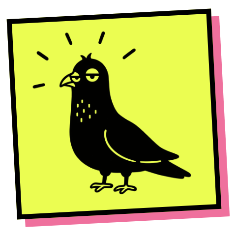
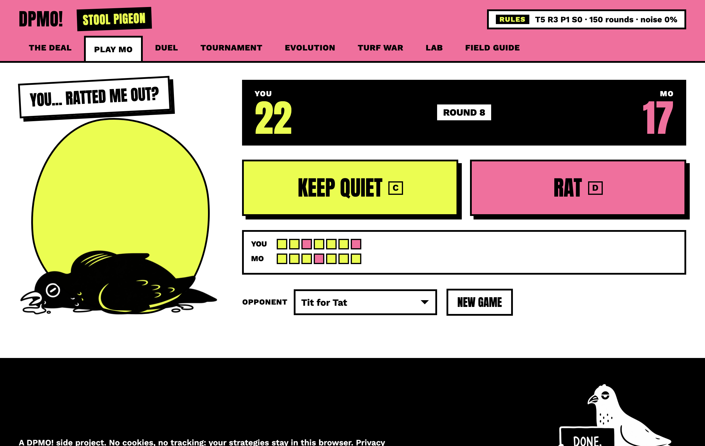
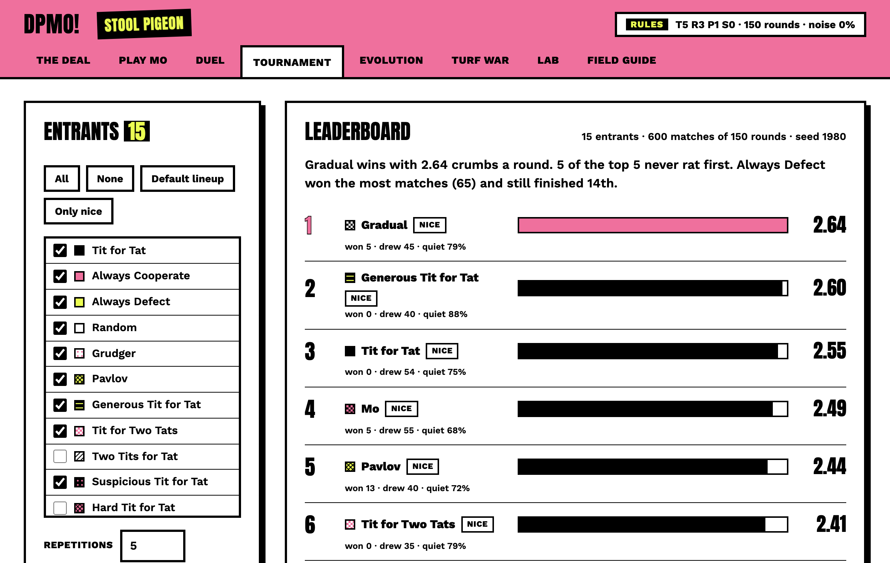
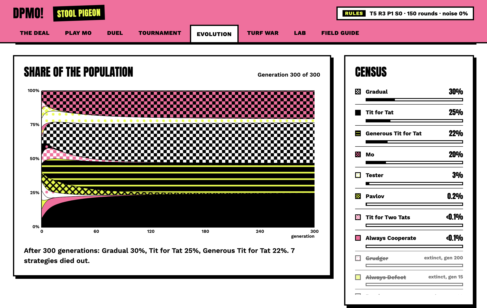
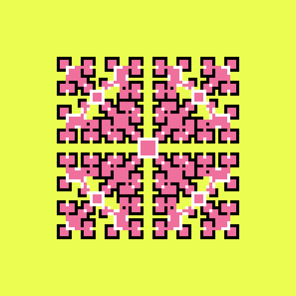
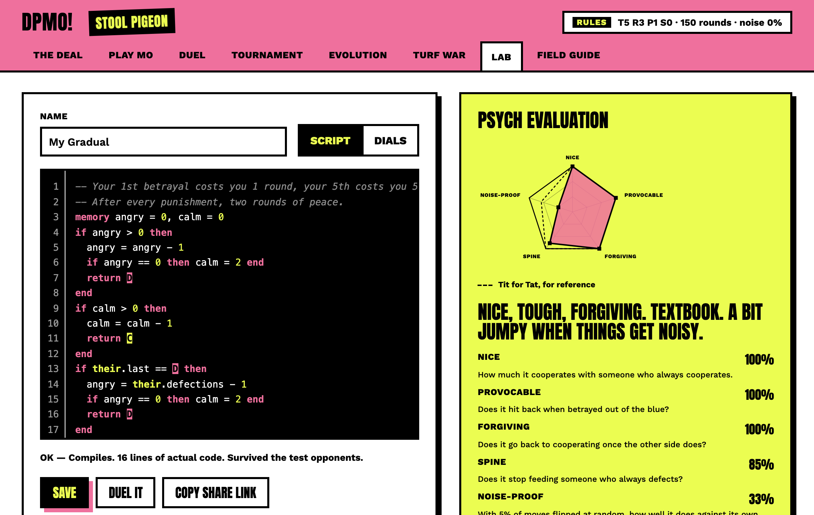

<p align="center">
  
</p>

<h1 align="center">Stool Pigeon</h1>
<p align="center"><b>The prisoner's dilemma, played by pigeons</b><br>
A game theory lab in the browser. Plain JavaScript, no build step, no dependencies.</p>

<p align="center"><a href="https://donotpissmeoff.com/dilemma/"><b>Play it at donotpissmeoff.com/dilemma</b></a></p>

<p align="center"></p>

---

Two pigeons get caught with a stolen baguette and questioned in separate cages. Each can keep quiet or rat the other out. Whatever the other one does, ratting pays more, yet if both rat they both end up worse off than if they had kept their beaks shut. Played once, it's a trap. Played two hundred times with the same bird, it becomes a question of trust, memory and grudges: in 1980 Robert Axelrod had programs play it against each other, and a strategy four lines long beat all the others.

This is a place to poke at all of that. (A stool pigeon is a police informer. The site's mascot is a pigeon. It had to be.)

## Features

**Play Mo**
- You against a strategy Mo won't name, for a number of rounds nobody tells you. Keys `C` and `D`.
- At the end you guess who he was. A wrong guess still counts if that strategy would have made exactly the same moves against you.
- Then you see what Tit for Tat, Always Defect and the others would have scored against him, with the same coin flips.

**Duel**
- Any two strategies, one match. Every move on a tape, moves flipped by noise crossed out, the running score, how the rounds ended.

**Tournament**
- Axelrod-style round robin with 22 classics and your own strategies, run in a Web Worker.
- Ranked by crumbs per round, not by matches won. Always Defect wins the most matches and finishes near the bottom.
- A "who beat whom" matrix: click any square to watch that duel.

**Evolution**
- Replicator dynamics on the tournament's payoffs: 10,000 pigeons, and better scorers have more chicks.
- Start with equal shares, with 90% defectors, or with a single strategy invading at 1%. Optional mutation.

<table>
  <tr>
    <td></td>
    <td></td>
  </tr>
</table>

**Turf war**
- Spatial games on a torus. Every cell plays its eight neighbours, then copies the best scorer around it.
- Classic Nowak–May mode (pure cooperators and defectors, temptation *b*) or up to four strategies fighting over the grid. Paint cells with the mouse.

<p align="center"><br>
<sub>One defector among cooperators, <i>b</i> = 1.85. Lime keeps quiet, pink rats, white and black just switched sides.</sub></p>

**Lab**
- Write a strategy in Pigeon script, or set five memory-one dials (Tit for Tat, Pavlov, Generous TFT and Extort-2 are presets).
- It is checked as you type: errors with line and column, a psych profile against fixed probes (nice, provocable, forgiving, spine, noise-proof), and a field test against the classics.
- Saved strategies play in every section. A share link carries the strategy in the URL fragment, so it never reaches the server.

<p align="center"></p>

**Field guide and house rules**
- All 22 strategies with their source and profile, each one click away from a duel or a fork.
- Payoffs, noise, fixed or unknown match length, and a seed. Same seed, same results, down to the last coin flip.

## Pigeon script

The server sends `Content-Security-Policy: default-src 'self'`, which rules out `eval` and `new Function`, and strategies arrive from links written by strangers. So they are written in a small language with its own lexer, parser and compiler ([js/lang.js](js/lang.js)) that turns the source into plain closures. There are no loops and no recursion: every program finishes in a handful of steps and can see nothing but the match.

```lua
-- Mo: Tit for Tat, but three betrayals and that's it.
if their.defections >= 3 then return D end
if round == 1 then return C end
return their.last
```

The built-in strategies are written in it too ([js/strategies.js](js/strategies.js)), which is what makes them forkable. Errors point at a line and column, and the common slips get a straight answer (`Moves are uppercase: C`, `"==" compares; use "=" to assign`). The full reference is in the Lab.

## How it's built

**No framework, no build.** ES modules served as they are, one stylesheet, about 3,500 lines of JavaScript. The engine ([js/engine.js](js/engine.js)) doesn't touch the DOM, so the same file runs in the page, in the tournament worker and under `node --test`.

**Reproducible.** Every match gets its own random streams, one per player and one for noise, derived from the seed and the two players (mulberry32). Results don't depend on the order matches run in: a tournament in the worker and the same tournament in the tests agree to the last decimal.

**Four colours, twenty-two strategies.** The brand allows pink, lime, black and white, nothing else. To tell strategies apart, each one gets a colour plus a print pattern (dots, stripes, checks), like a risograph zine, and keeps it everywhere on the page.

**Charts by hand.** Canvas for the tape, the line and area charts and the grid, SVG for the radar. The grid is drawn one pixel per cell and scaled up without smoothing. The animation above comes from the same engine, written out as an animated PNG by [dev/kaleidoscope.mjs](dev/kaleidoscope.mjs).

**Tested in a real browser.** [dev/smoke.mjs](dev/smoke.mjs) opens every section in headless Chrome under the production CSP, presses the buttons, and fails on any console error or policy violation. It drives Chrome through the DevTools protocol over Node's built-in WebSocket, so there is nothing to install. GitHub Actions runs it, together with the unit tests, on every push.

## Run it locally

```sh
python3 dev/serve.py
```

then open http://localhost:8800/dilemma/. The script serves the folder under `/dilemma/` with the same security headers as production, so a CSP mistake shows up on your machine first. Any other static server works too.

Tests:

```sh
node --test tests/*.test.js
node dev/smoke.mjs
node dev/smoke.mjs --width 390
```

The smoke test needs Chrome; set `CHROME` to its path if it isn't in the usual macOS location.

## Deploy

`./deploy.sh` runs the tests, then copies the public files to the server. The site is served by the same Caddy as [donotpissmeoff.com](https://github.com/El3k0n/donotpissmeoff), from its own web root; [deploy/README.md](deploy/README.md) has the route.

## Rights

The code is released under the [MIT License](LICENSE). Mo the pigeon, his artwork and the "Don't Piss Me Off!" name are © Diego Pignattini and not covered by it. The fonts (Anton, Work Sans) are under the SIL Open Font License; their licence texts are in [assets/fonts](assets/fonts).
